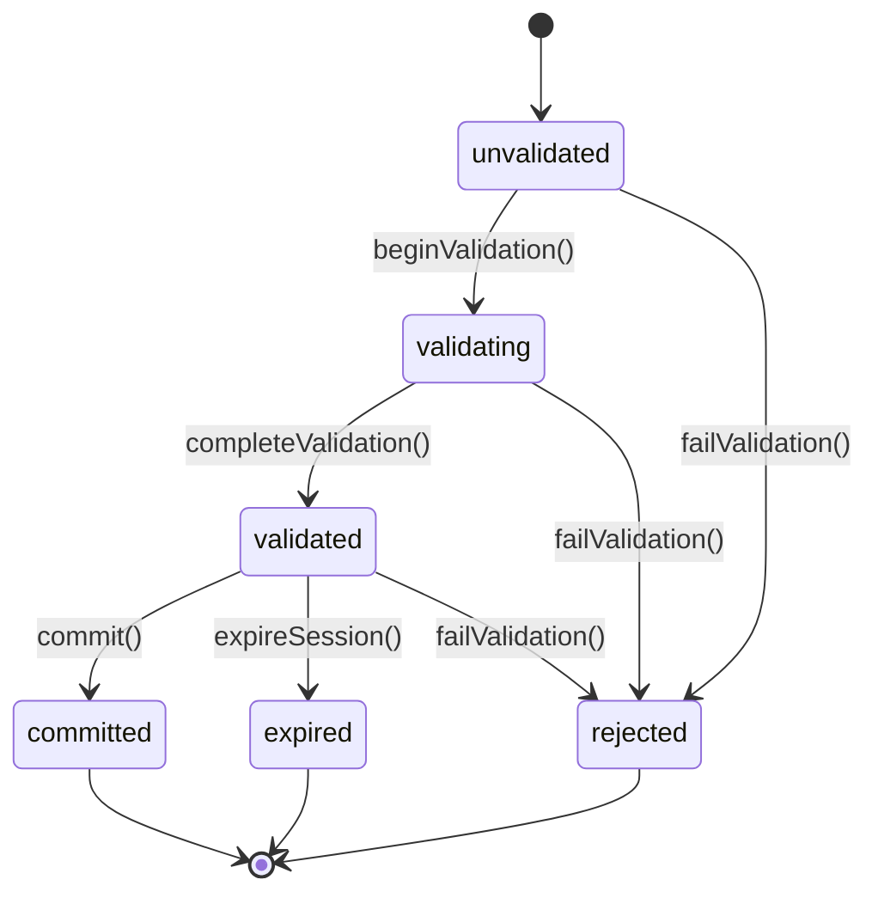

# Proof Input Validation and Lifecycle State Handling

This document specifies the behavior, validation rules, lifecycle state handling, error reporting, and privacy preservation guarantees of the SDK's zero-knowledge proof input validation module (`@zk-payroll/core/proofs`).

## Overview

In zero-knowledge payroll processing, proof inputs (witness payloads) contain private financial metadata and cryptographic inputs used to construct off-chain zk-SNARK proofs. Before these inputs enter circuit witness generation, the SDK performs defensive validation to prevent:

1. **Malicious or malformed inputs**: Overflowing circuit limits, exceeding field boundaries, or containing unsupported data types.
2. **Credential and secret leaks**: Sensitive private keys, access tokens, API credentials, or seeds accidentally provided in witness payloads.
3. **Invalid execution states**: Submitting proof requests against finalized (executed, cancelled, or failed) payroll runs.
4. **Data leakage in diagnostics**: Telemetry, logs, or error responses echoing raw salary numbers, recipient public keys, or confidential payroll figures.

---

## Validation Pipeline & Invariants

The validation pipeline enforces five foundational guarantees:

### 1. Circuit Input Boundaries & Scalar Field Range
- **Field Limit**: Maximum 256 fields per witness (configurable via `maxFields`).
- **String Length**: Maximum 256 characters per string field (configurable via `maxStringLength`).
- **Field Order**: All numeric values must lie strictly within the BN254 elliptic curve scalar field order:
  $$\mathbb{F}_r = 21888242871839275222246405745257275088548364400416034343698204186575808495617$$

### 2. Forbidden Credentials & Sensitive Fields
To protect operational security, proof inputs must never contain private credentials or secrets. The following fields are strictly prohibited and immediately reject validation:
- `privateKey`, `secretKey`, `secret`, `password`, `mnemonic`, `seed`
- `apiKey`, `accessToken`, `refreshToken`, `signingKey`, `adminKey`, `authHeader`

### 3. Amount and Recipient Normalization
- **Amount**: Normalized to a canonical non-negative integer representation. Fractional or negative values are rejected.
- **Recipient**: Validated as non-empty string identifier (e.g. Stellar public key or Soroban address).
- **Asset**: Validated as a non-empty asset identifier (e.g. `native` or `USDC:ISSUER`).

---

## Lifecycle State Machine & Hardening (#918)

Proof inputs progress through an explicit, one-way state machine managed by `ProofInputStateManager`:



### State Definitions

| State | Description | Allowed Next States |
| --- | --- | --- |
| `unvalidated` | Initial raw witness received from caller. | `validating`, `rejected` |
| `validating` | Witness undergoing boundary, forbidden field, and type checks. | `validated`, `rejected` |
| `validated` | Witness normalized and sanitized; frozen against tampering. | `committed`, `expired`, `rejected` |
| `rejected` | Validation failed; record preserved with safe violation descriptors. | *Terminal* |
| `committed` | Witness synthesized into circuit and submitted. | *Terminal* |
| `expired` | Proof input validity window elapsed. | *Terminal* |

### State Hardening Invariants

1. **Terminal Run Protection**: Proof input validation cannot start against a payroll run that is already in a terminal state (`executed`, `cancelled`, or `failed`).
2. **Witness Immutability**: Upon entering the `validated` state, the sanitized witness payload is deeply frozen (`Object.freeze`), guaranteeing that concurrent processes cannot mutate witness parameters prior to proof synthesis.
3. **Concurrency Protection**: All state transitions support optimistic concurrency via version numbers. Conflicting concurrent updates trigger a `ProofInputStateError` (`PROOF_INPUT_CONCURRENT_STATE_MODIFICATION`).
4. **Audit Hash Integrity**: Each state record computes a tamper-evident SHA-256 fingerprint of session metadata (`computeProofInputStateHash`), enabling cryptographic verification of the session lifecycle without logging witness data.

---

## Safe Error Model & Privacy Preservation

When validation fails, errors use typed error classes that never echo private payroll details:

- **Class**: `ProofInputValidationError` (extends `ProofGenerationError` and `ZkPayrollError`).
- **State Error Class**: `ProofInputStateError` (extends `ZkPayrollError`).

### Privacy Invariants
- **No Amount Exposure**: Error messages and violation objects never contain salary amounts, total payroll payouts, or numeric balances.
- **No Recipient Exposure**: Employee identifiers, addresses, and public keys are redacted.
- **Safe Context**: Error context contains only operational metadata such as `field` name, `code`, `sessionId`, and `suggestedFix`.

### Error Codes

| Error Code | Meaning |
| --- | --- |
| `PROOF_INPUT_INVALID_WITNESS` | Witness payload is null, undefined, or not a plain object. |
| `PROOF_INPUT_FORBIDDEN_FIELD` | Witness contains forbidden credential/secret keys. |
| `PROOF_INPUT_TOO_LARGE` | Witness exceeds allowable field count or circuit size limits. |
| `PROOF_INPUT_INVALID_AMOUNT` | Amount representation is negative, fractional, or non-numeric. |
| `PROOF_INPUT_INVALID_RECIPIENT` | Recipient address format is empty or invalid. |
| `PROOF_INPUT_INVALID_ASSET` | Asset identifier is invalid or empty. |
| `PROOF_INPUT_MISSING_REQUIRED_FIELD` | A required circuit field is missing. |
| `PROOF_INPUT_ILLEGAL_STATE_TRANSITION` | Attempted illegal lifecycle state transition. |
| `PROOF_INPUT_FINALIZED_RUN_BLOCKED` | Proof input validation blocked because payroll run is finalized. |

---

## API Reference & Usage

### 1. Basic Witness Validation

```typescript
import { validateProofInput, assertValidProofInput } from "@zk-payroll/core";

// Non-throwing validation
const result = validateProofInput(witness, {
  requiredFields: ["recipient", "amount", "asset"],
});

if (!result.isValid) {
  console.error("Violations:", result.violations);
  return;
}

// Access normalized, safe witness
const sanitized = result.sanitized;
```

### 2. State-Managed Validation Session

```typescript
import { ProofInputStateManager } from "@zk-payroll/core";

const stateManager = new ProofInputStateManager();
const session = stateManager.create({
  sessionId: "session_001",
  circuitId: "payroll_merkle_v1",
  runId: "run_9f83c18b7654a1d2e3f4b5c6a7b8c9d0e1f2a3b4c5d6e7f8a9b0c1d2e3f4a5b6",
});

// Step 1: Begin validation (enforces non-terminal run check)
stateManager.beginValidation(session.sessionId, { runStatus: "draft" });

// Step 2: Validate witness inputs
const validationResult = validateProofInput(rawWitness);
if (validationResult.isValid) {
  stateManager.completeValidation(session.sessionId, validationResult.sanitized!);
} else {
  stateManager.failValidation(session.sessionId, validationResult.violations);
}

// Step 3: Commit witness to circuit
stateManager.commit(session.sessionId);
```

---

## Payroll Witness Payload Limits (#990)

`assertValidPayrollWitness()` (the boundary `payroll.ts` calls before any proof
generator) now runs `assertCircuitInputSize()` first, so custom
`IProofGenerator` implementations never receive an oversized witness. Defaults
come from `DEFAULT_CIRCUIT_INPUT_LIMITS`:

| Limit | Default |
|---|---|
| `maxFields` | 256 top-level fields |
| `maxElements` | 4096 leaf values |
| `maxDepth` | 4 levels of nesting |
| `maxStringLength` | 128 characters |
| `maxTotalBytes` | 64 KiB serialized |

Pass a second `limits` argument to override any of them. A violation throws
`ProofGenerationError` with code `PROOF_INPUT_TOO_LARGE`; its context holds only
`limit`, `max`, `actual` and the field name — never witness values.

## Unsupported Proof Formats (#852)

`verifyProofWithAdapter()` / `ProofVerificationClient.verifyProof()` accept only
`SUPPORTED_PROOF_FORMATS` (`groth16` over `bn128`). A structurally valid proof
in any other protocol/curve (including a missing one) throws
`UnsupportedProofFormatError` (`code: "PROOF_UNSUPPORTED_FORMAT"`, a
`ProofVerificationError`) before the adapter runs. It is not retryable:
regenerate the proof with the supported toolchain. Its `protocol`/`curve`
fields echo only short identifier-like labels; anything else becomes
`[unrecognized]`. Structurally broken proofs still return a `malformed` verdict.
Use `isSupportedProofFormat()` / `assertSupportedProofFormat()` to check early.
